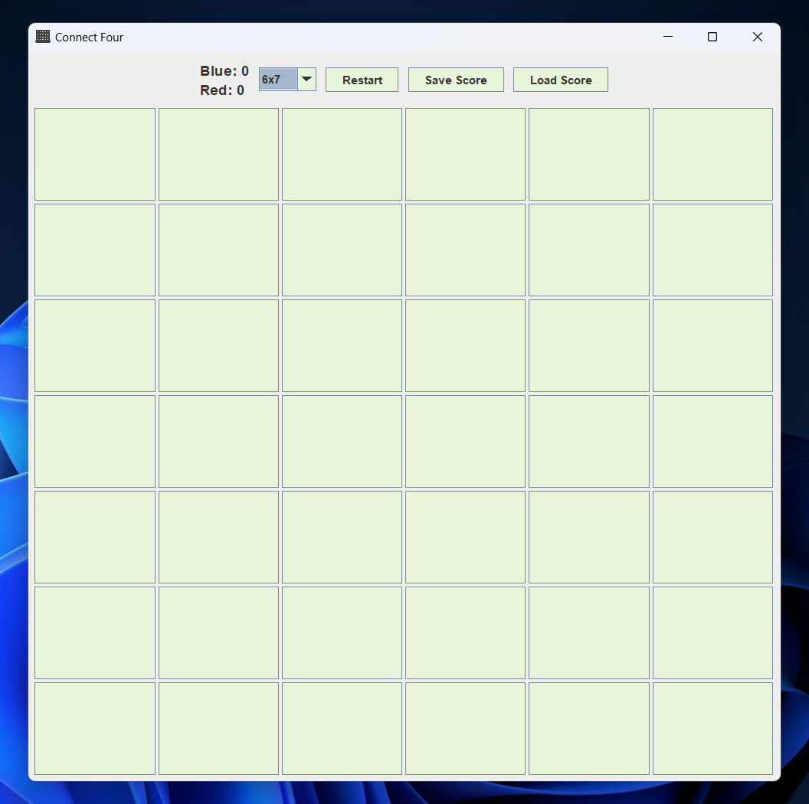
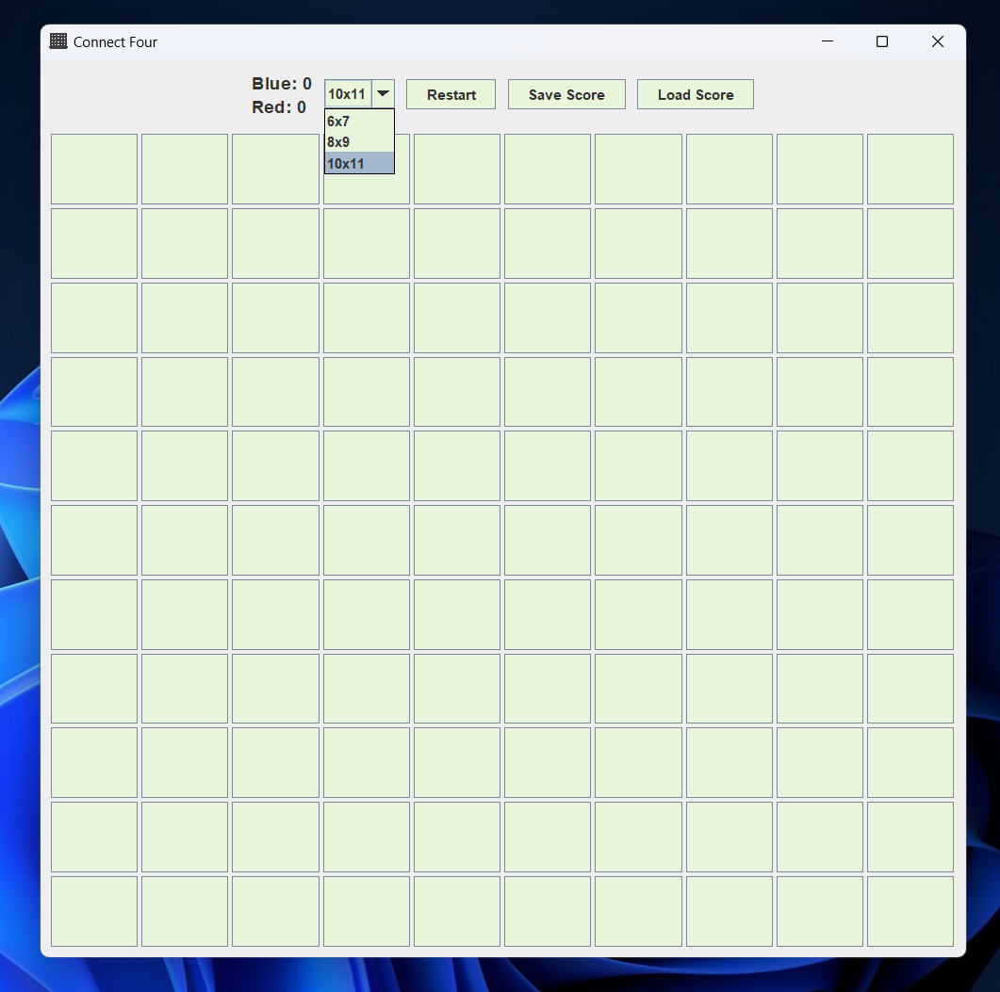
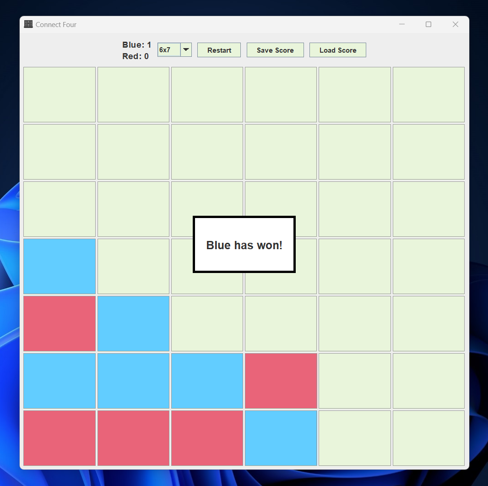
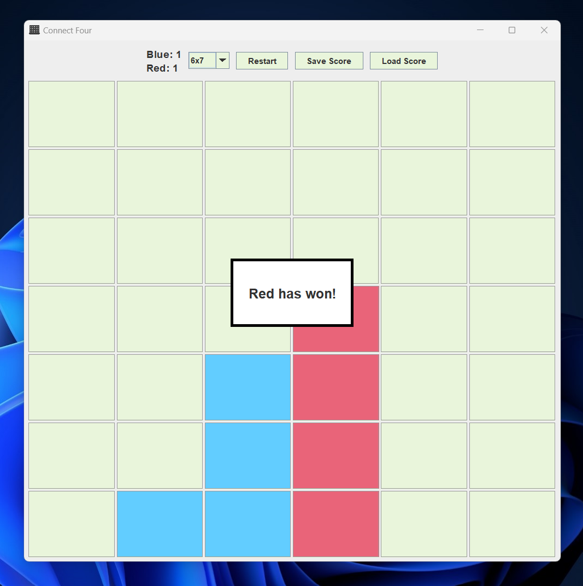

# Connect Four

A two-player Connect Four desktop game built in Java with Swing. Players can choose from three board sizes, take turns dropping pieces into columns, and play until one player connects four pieces.

## Features

- Local two-player gameplay with alternating blue and red turns.
- Three selectable board sizes: 6×7, 8×9, and 10×11.
- Automatic horizontal, vertical, and diagonal win detection.
- Winner notification and disabled board after a win.
- Restart the board while keeping the session score.
- Save and load the blue and red scores using a local `score.txt` file.

## Screenshots

### 6×7 game board



### Board-size selection



### Blue wins



### Red wins



## Technology

- Java 11+
- Swing and AWT
- Apache Ant / Apache NetBeans project

## Run the game

### NetBeans

Open the project folder in Apache NetBeans and run the `Connect4` project.

### Command line

Install JDK 11 or newer and Apache Ant. From the project root, build and launch the application:

```powershell
ant clean jar
java -jar dist/Connect4.jar
```

The game writes `score.txt` in the current working directory. Run the commands from the project root so the score file stays there.

## Project structure

```text
src/connect4/Connect4.java  Game logic and Swing interface
src/connect4/Connect4.png   Application window icon
screenshots/                README screenshots
```
